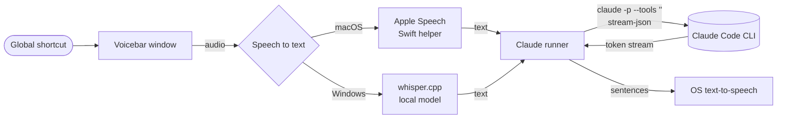

<div align="center">

# Voicebar

**Ask Claude out loud, from anywhere on your desktop. Hear the answer in Vietnamese or English.**

A menu-bar / system-tray voice assistant for macOS and Windows that drives the
[Claude Code CLI](https://docs.claude.com/en/docs/claude-code) you already have installed and signed in.

[](https://github.com/tuananhhust05/voicebar/actions/workflows/ci.yml)
[](LICENSE)


[English](README.md) · [Tiếng Việt](README.vi.md)

</div>

> [!NOTE]
> **Project status: v1 in active development.** The working web prototype lives in
> [`legacy/web-prototype`](legacy/web-prototype). The desktop app is being built against the
> [design spec](docs/superpowers/specs/2026-11-07-desktop-voice-assistant-design.md).
> See the [roadmap](#roadmap) for what is done.

## Why

Typing a question breaks your flow. Voicebar is one shortcut away: press
<kbd>⌥ Space</kbd> (macOS) or <kbd>Ctrl Alt Space</kbd> (Windows), speak, and stop talking.
The question goes to Claude when you go quiet, and the answer starts playing
sentence by sentence while Claude is still writing it.

## Features

- **Global shortcut, hands-free.** Tap to listen. It sends automatically after a short silence.
- **Bilingual.** Vietnamese and English speech recognition and speech output.
- **Streaming speech.** The first sentence plays before the full answer arrives.
- **Ask about your clipboard.** A second shortcut attaches the text you just copied ("translate this", "summarise this").
- **Conversation history.** Pick up any past conversation; Claude remembers the context.
- **Uses your own Claude CLI.** No API keys and no extra account. Your existing `claude` login is reused.
- **Locked-down by design.** Claude runs with tools, MCP servers and user settings disabled, so it can only talk.

## How it works



| Layer          | macOS                                                     | Windows                                                  |
| -------------- | --------------------------------------------------------- | -------------------------------------------------------- |
| Shell          | Electron menu-bar app                                     | Electron tray app                                        |
| Speech to text | Apple Speech (`SFSpeechRecognizer`), live partial results | `whisper.cpp`, multilingual `small` model, fully offline |
| Text to speech | System voices (e.g. _Linh_, _Samantha_)                   | System voices (e.g. _Microsoft An_, _Microsoft Zira_)    |
| Claude         | Local `claude` CLI                                        | Local `claude.exe` / `claude.cmd`                        |

Engineering notes:

- **Process isolation.** The renderer is sandboxed (`contextIsolation`, no Node, strict CSP).
  It talks to the main process only through a typed `contextBridge` API, and every IPC payload is validated.
- **No shell injection surface.** The question is passed to the CLI over stdin, never as an argument.
  Model names and session IDs are validated against strict patterns.
- **Whisper hallucination guard.** Very short or quiet clips and the known phantom phrases
  Whisper emits on silence are dropped before anything reaches Claude.

The full design, including the trade-offs considered, is in the
[design spec](docs/superpowers/specs/2026-11-07-desktop-voice-assistant-design.md).

## Requirements

- macOS 13+ (Apple Silicon or Intel) or Windows 10/11 x64
- [Claude Code CLI](https://docs.claude.com/en/docs/claude-code) installed and signed in (run `claude`, then `/login`)
- A system voice for the language you want to hear:
  - macOS: _System Settings → Accessibility → Spoken Content → System voice → Manage voices_ → Vietnamese _Linh_
  - Windows: _Settings → Time & language → Language & region → Add Vietnamese_ (includes _Microsoft An_)

## Development

```bash
git clone https://github.com/tuananhhust05/voicebar.git
cd voicebar
npm install
npm run dev        # start Electron with hot reload
```

| Script                                  | What it does                           |
| --------------------------------------- | -------------------------------------- |
| `npm run dev`                           | Run the app in development mode        |
| `npm run lint`                          | ESLint (flat config, type-aware)       |
| `npm run typecheck`                     | TypeScript, no emit                    |
| `npm test`                              | Vitest unit tests                      |
| `npm run format`                        | Prettier                               |
| `npm run dist:mac` / `npm run dist:win` | Build installers with electron-builder |

See [CONTRIBUTING.md](CONTRIBUTING.md) for the workflow and conventions.

## Roadmap

- [x] Web prototype: browser speech → Claude CLI bridge → streaming TTS ([`legacy/web-prototype`](legacy/web-prototype))
- [x] Desktop design spec
- [ ] Claude runner (CLI discovery, safe args, stream parsing, cancellation)
- [ ] Tray app, floating window, global shortcuts
- [ ] macOS speech helper (Apple Speech)
- [ ] Windows speech engine (whisper.cpp + VAD)
- [ ] Settings window and conversation history
- [ ] Clipboard context shortcut
- [ ] Signed installers and auto-update

## Privacy

- Your questions and Claude's answers go to Anthropic through the Claude CLI under your own account.
- On Windows, speech recognition runs entirely on your machine.
- On macOS, Apple Speech may process audio on Apple's servers for languages without on-device support.
- Conversation history is stored locally in the app's data folder and never uploaded.

## Security

Please report vulnerabilities privately. See [SECURITY.md](SECURITY.md).

## License

[MIT](LICENSE) © 2026 tuananhhust05

Voicebar is an independent project and is not affiliated with, endorsed by or sponsored by
Anthropic. "Claude" and "Claude Code" are trademarks of Anthropic PBC.
